  

  <a href="YOUR_PORTFOLIO_URL"><b>🖥️ Portfolio — it's a cartoon OS, go poke it</b></a> ·
  <a href="https://www.linkedin.com/in/prep-srijan/">LinkedIn</a> ·
  <a href="mailto:pretest0505@gmail.com">Email</a>

  

### 🔧 PREP · *in development* · [case study](YOUR_PORTFOLIO_URL)
Connects citizen-reported problems with universities, researchers, NGOs and government (SIH26043).  
Separate NestJS services · org-scoped roles · AI classification + duplicate detection · media service on Cloudinary.  
`NestJS` `TypeScript` `PostgreSQL` `TypeORM` `JWT`

### 💬 [PREYTweet](https://github.com/PREPMND/ytweet) · *ongoing* · [live](https://preytweet.netlify.app)
Social app with a backend focus.  
JWT access/refresh with cookies · role-based auth · Redis caching & Pub/Sub · Socket.IO chat with presence and typing.  
`Node.js` `Express` `MongoDB` `Redis` `Socket.IO` `Docker`

### ✍️ BlogMate · [live](https://blogmate-plum.vercel.app)
AI blogging platform where slow work leaves the request.  
Thumbnails generate in a BullMQ background queue · Better Auth · Drizzle on PostgreSQL · Cloudinary media.  
`Next.js` `TypeScript` `PostgreSQL` `BullMQ` `Redis`

### 🧩 [@preplabs/validator](https://github.com/PREPMND/preplabs-validator) · [npm](https://www.npmjs.com/package/@preplabs/validator) · 150+ downloads
Fluent, zero-dependency TypeScript validation library.  
`string().min(3).max(20)` · `safeCheck()` → `{ ok, error }` · built-in username/password rules · regex utilities.

### 🧠 Mini Redis · *starting*
A key-value store in Go, from first principles — TCP, concurrent clients, TTL expiration, persistence.

### 🎬 PREPWatch · [live](https://prepwatch.netlify.app)
Movie discovery app — TanStack Query caching, dynamic routing, trailers.

---

**Intern @ Lili Infotech** (video-call service, admin portals) · **Open source:** contributed to Fishman, a Postman alternative (Tauri · Rust) · **200+ LeetCode** · CS @ MAIT Delhi, 2029
