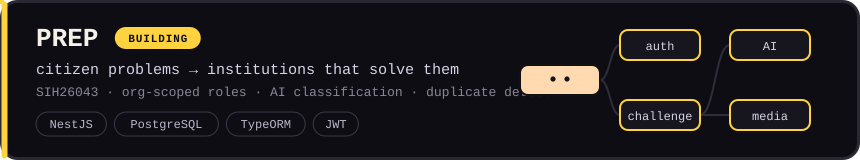
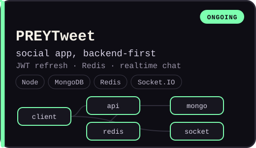
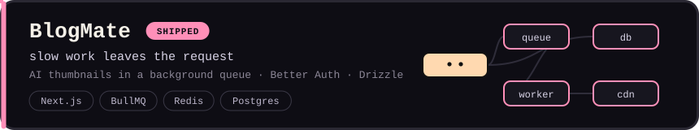
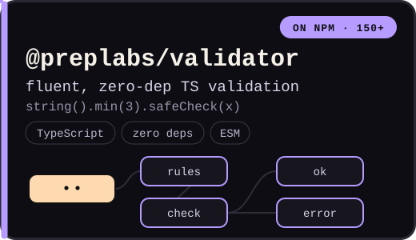
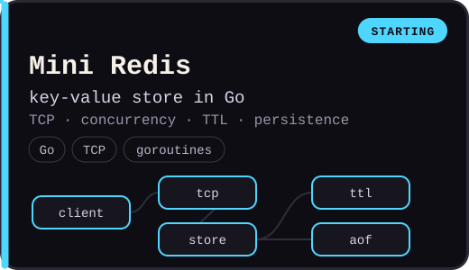

  
  
  
  

CS @ **MAIT Delhi** · intern @ **Lili Infotech** · open-source contributor to **Fishman** · 200+ LeetCode  
I build backend services, auth, async workflows, and the tools to poke at them.  
My portfolio is a tiny cartoon OS with a working terminal. [Go break it.](https://prep-srjn.netlify.app/?theme=os)

 

 

  

live: <a href="https://preytweet.netlify.app">preytweet</a> · <a href="https://blogmate-plum.vercel.app">blogmate</a> · <a href="https://prepwatch.netlify.app">prepwatch</a>

