**Backend-focused CS undergraduate** at MAIT Delhi (2029) · Intern at **Lili Infotech**  
I build services, authentication, data models and asynchronous workflows, and I'm moving toward systems programming in Go.

[Portfolio](https://prep-srjn.netlify.app) · [LinkedIn](https://www.linkedin.com/in/prep-srijan/) · [Email](mailto:pretest0505@gmail.com) · [npm](https://www.npmjs.com/package/@preplabs/validator)

---

### Work

**PREP** — *in development* · [case study](https://prep-srjn.netlify.app)  
Platform for SIH26043 connecting citizen-reported problems with universities, researchers, NGOs and government bodies.  
Separate NestJS services (auth, challenges, organizations, media, solutions, workspaces), organization-scoped roles, AI-assisted classification and duplicate detection.  
`NestJS` `TypeScript` `PostgreSQL` `TypeORM`

**[PREYTweet](https://github.com/PREPMND/ytweet)** — *ongoing* · [live](https://preytweet.netlify.app)  
Social media application built backend-first: JWT access/refresh tokens with cookies, role-based authorization, Redis caching and Pub/Sub, and Socket.IO messaging with presence and typing indicators.  
`Node.js` `Express` `MongoDB` `Redis` `Socket.IO` `Docker`

**BlogMate** — [live](https://blogmate-plum.vercel.app)  
AI blogging platform that moves slow work out of the request cycle — thumbnails are generated in a BullMQ background queue.  
`Next.js` `TypeScript` `PostgreSQL` `Drizzle` `BullMQ`

**[@preplabs/validator](https://github.com/PREPMND/preplabs-validator)** — [npm](https://www.npmjs.com/package/@preplabs/validator) · 150+ downloads  
Fluent, zero-dependency TypeScript validation library with safe and throwing modes.  
`TypeScript`

**Mini Redis** — *starting*  
A key-value store in Go built from first principles: TCP server, concurrent clients, TTL expiration and persistence.  
`Go`

**PREPWatch** — [live](https://prepwatch.netlify.app)  
Movie discovery app using TanStack Query for server-state caching.  
`React` `TanStack Query`

---

### Also

Open-source contribution to **Fishman**, a Tauri + Rust API client · 200+ LeetCode problems

### Stack

`TypeScript` `Go` `Node.js` `NestJS` `Express` `PostgreSQL` `MongoDB` `Redis` `BullMQ` `Socket.IO` `Docker` `React` `Next.js`

The portfolio is a small interactive OS — it has a working terminal and a toy key-value store. <a href="https://prep-srjn.netlify.app/?theme=os">Try it</a>.
